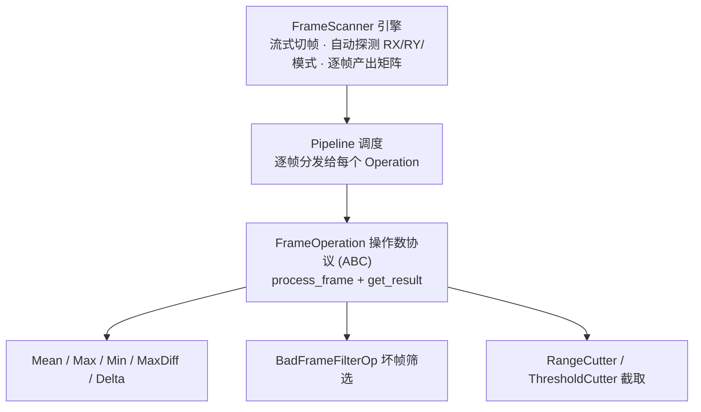

# DataProcessTool · 数据处理工具

> 触控面板（Touch Panel）采集数据的**桌面级后处理工作台** —— 面向触控应用 / 系统工程师，把「CSV 帧数据处理 → 通道映射 → 信号分析 → 参数寻优」串成一条流水线的 GUI 工具。
>
> 纯 Python + Tkinter 实现，零重型 GUI 依赖；`numpy` 负责数值，`matplotlib` 按需懒加载只用于绘图。当前版本 **V6.2（2026-08）**，可 PyInstaller onefile 打包为 Windows 单文件。

---

## ✨ 特性一览

- **CSV 帧流处理**：文件截取（帧号区间 / 连续超阈值段）、坏帧命中筛选、帧级统计（均值 / 最大 / 最小 / 极差 / 相邻帧差）
- **通道 MAPPING 重排**：把按面板物理布局采集的数据重排成 IC 期望的扫描/上报通道序，一键生成可直接下发的数值串
- **共模干扰扫描参数建模**：驱动波形参数与外部噪声频点之间支持**正 / 反向**两种计算（由配置得频点覆盖、由干扰频点反求可行参数）
- **多配置 SNR 计算与交互绘图**：多组波形配置同屏对比、频点 SNR 曲线 + 阈值线，自动标注低于阈值的未覆盖区间
- **最优配置寻优**：给定目标频点与权重，在参数网格上穷举，输出**加权 SNR 最大**的配置
- **多任务不卡界面**：文件处理跑后台线程，日志经线程安全队列轮询刷新、进度条实时更新，多个功能 Tab 可并发处理
- **工程细节**：vista/clam 主题一键切换、模块懒加载提升启动速度、运行日志高度自适应、PyInstaller 打包后任务栏图标正常

---

## 🖥 界面结构

```
主窗口（一级 Notebook）
├─ CSV文件处理
│    ├─ 文件截取     帧号范围 / 连续超阈值两种截取
│    ├─ 坏帧筛选     max/min 命中区间筛选 + 排除点 + 输出文件
│    └─ 帧统计       mean / max / min / max-min / delta 逐点统计
├─ MAPPING映射       通道重排 + 目标格式下发串生成（多映射模式）
├─ 共模扫描参数分析
│    ├─ 反向覆盖    已知干扰频点 → 枚举可行扫描参数
│    ├─ 频点反推    已知扫描配置 → 计算覆盖 / 受扰频点
│    ├─ 多配置 SNR  多配置 SNR 曲线对比 + 阈值标注
│    └─ 最优寻优    带权目标频点的参数网格搜索
└─ 炼丹炉           彩蛋模块：纯 Tk 逐帧动画（无外部资源）
```

每个功能页底部共享一块「运行日志」区；子页面切换时日志区高度按参数区自适应。

---

## 🚀 快速开始

环境要求：Windows / Python ≥ 3.10（3.13 已验证），`tkinter`（官方安装包自带）。

```bash
# 1. 安装依赖
pip install -r requirements.txt      # numpy、pyinstaller

# 2. 源码运行
python main.py

# 3. 打包为单文件 exe（Windows）
pyinstaller 数据处理工具.spec
```

运行后配置存放在 `%APPDATA%\DataProcessTool\config.json`，首次启动自动从内置默认配置生成，各功能页参数会自动记忆。

---

## 🧩 功能说明

### 1. CSV 帧处理

触控采集 CSV 是一段**帧流**：一帧 = 若干元数据行（帧类型/头尾行，随扫描模式不同而带缓冲行）+ `RY 行 × RX 列` 的整型数据矩阵。程序可**自动探测 RX / RY / 扫描模式**：按「整数值列计数」定 RX，按数据块与元数据块的连续性定 RY 与模式，再以「总行数 ÷ 帧长」整除校验自动纠正误判，逐帧**流式读取**，内存占用不随文件增大。

| 子功能 | 说明 |
| --- | --- |
| 文件截取 | 按帧号区间原样切出；或「帧内最大值连续 N 帧 ≥ 阈值」截出连续超阈值段 |
| 坏帧筛选 | 命中帧内 max/min 落在目标区间的帧，支持排除指定点位后重算极值、TopN、按原序/降序、导出 CSV |
| 帧统计 | 逐元素 mean / max / min / max-min / 相邻帧差，结果可直接导出为标准帧格式 |

### 2. MAPPING 通道重排

将按面板物理通道排列的 RX 数据，按映射表重排为 IC 固件期望的通道序，并对未映射位按填充值补齐，输出**单行数值串**用于寄存器下发。数据源支持手动粘贴 / 从 CSV 首帧自动提取；映射模式自动列出当前内置数据中可用的项。

### 3. 共模扫描参数分析

把触摸屏扫描驱动波形（含平顶/间隔的分段电压扫描）与外部共模噪声频点建模成解析关系，处理两类问题：

- **正向（配置 → 频点）**：给定一组扫描波形参数，推算该配置能覆盖 / 会受扰的干扰频点与周期约束；
- **反向（频点 → 配置）**：给定目标干扰频点，在参数网格上枚举满足覆盖约束的可行组合，供快速选型；
- **多配置 SNR**：输入多组波形配置，对频带内各频点计算解析 SNR，同屏绘制曲线并在阈值下标注未覆盖区间（matplotlib 交互：滚轮缩放、吸附取值、参考线保护）；
- **最优配置寻优**：给出目标频点与权重，设定各参数网格（步长按小数精度自动推断），穷举并输出加权 SNR 最大者。

### 4. 炼丹炉（彩蛋）

一个「圆腹鼎式八卦炉」逐帧动画：材料投入飞入、粒子喷发、炼丹出丹（丹药词库内置一份……打工人自嘲彩蛋）。纯 `Tk Canvas` + `after` 实现，无任何图片以外的资源依赖，作为高强度调试后放松心情的隐藏入口。

---

## 🏗 架构

采用「**三层分层 + 帧引擎与操作数解耦**」的结构：

```
main.py    ← Tkinter 主线程：组装 UI、主题、配置、日志轮询、事件循环
   │
   ├─ ui/    ← 纯表现层：Tab 布局、输入校验、线程调度、日志输出
   ├─ core/  ← 纯引擎：CSV 帧扫描、操作数协议、路径工具（不依赖 ui/）
   └─ logic/ ← 纯业务：SNR 计算、通道映射、寻优算法（不依赖 ui/）
```

依赖方向单向：`ui → logic / core`，`logic → core`，禁止反向，保证算法层可脱离 GUI 独立测试与复用。

**帧处理引擎**按「引擎 / 调度 / 操作数」三段式设计，新增功能时无需改动引擎：



- **可扩展性**：新增处理能力 = 新增一个 `FrameOperation` 子类，`FrameScanner`/`Pipeline` 零改动（开闭原则）；
- **线程模型**：所有文件处理跑后台 `threading.Thread`；日志经 `queue.Queue` 由主线程 `after(100ms)` 轮询；进度条每 50ms 读后台写入值；每个 Tab 持有独立 `stop_event`，可随时中断、可多 Tab 并发；
- **路径工具**：`core/paths.py` 统一处理用户配置目录（`%APPDATA%`）与 PyInstaller 打包后只读资源路径（`sys._MEIPASS`），ui / logic 不再各自拼路径；
- **布局经验**：Windows Tk 下 `ttk.Panedwindow` 行为不稳，窗口比例用 `pack_propagate(False)` + 动态高度计算实现。

---

## 🔧 工程要点

- **启动提速**：`matplotlib` 导入约 1.5s，仅「多配置 SNR」用到，故其 import 收敛在绘图函数体内做**懒加载**，启动路径上所有模块保持轻量；
- **关窗无卡顿**：绘图窗口 `WM_DELETE_WINDOW` 回调不做任何阻塞 I/O（如 savefig），直接销毁，避免拖死 Tk 主线程；
- **打包**：PyInstaller onefile + runtime hook 设置 `AppUserModelID`，解决 Windows 任务栏图标不显示；data 文件（图标 / changelog / 默认配置）经 `resource_path()` 兼容解析。

---

## 📄 采集数据格式约定（供二次开发参考）

- 帧流 CSV：`元数据行 + RY×RX 数据矩阵` 循环拼接，帧间元数据行数取决于扫描模式（含缓冲行的 MIX 类 / 无缓冲的 DIFF 类）；
- 自动探测失败时（如仅单帧数据）可在界面手动指定 RX / RY / 模式后重试。

---

## 🧭 Roadmap（个人迭代方向）

- [ ] 补充界面截图与操作演示
- [ ] Command / 寄存器直连调试模块（暂隐藏，待完善后开放）
- [ ] 算法模块接入命令行入口，便于 CI 与自动化批量跑数
- [ ] 补充核心引擎与算法的单元测试

---

## 🧹 脱敏说明

本仓库为个人工具的公开展示版，已做如下处理：

- `logic/cb_mapping.py` 中**除 MAPPING1（顺序映射）外的映射表，均已替换为等长随机置换的示例数据**，不代表任何真实面板的通道排布；数据结构、调用方式与算法流程保持不变。
- 仓库不含任何客户数据、真实 CSV 样本、厂商芯片参数或内部配置值。
- `config.json` 仅为界面默认值示例，可直接按需修改。

如需在真实面板上使用，请自行替换为对应面板的映射表。

## 📜 License

仓库暂未选择开源许可证（默认法律含义为「保留所有权利」）。如需对外开源使用，请先补充一份 `LICENSE` 文件。
